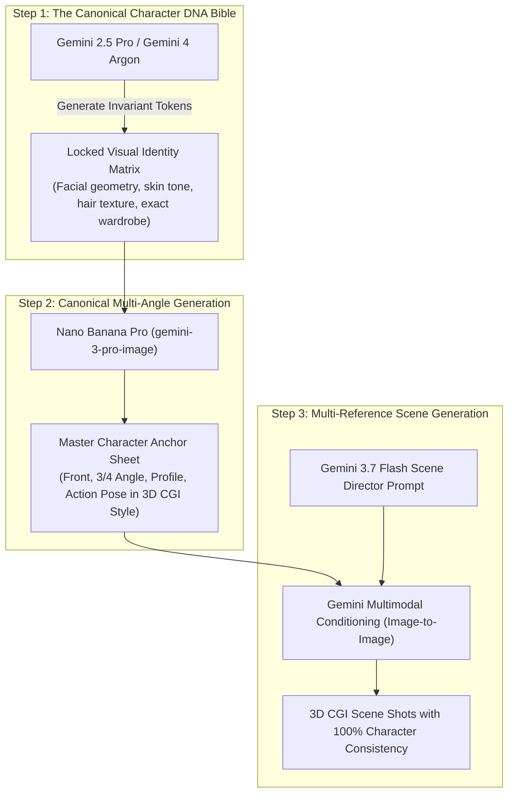

# Pure AI 3D Animated Video Studio: System Proposal & Technical Blueprint
**Autonomous High-End 3D CGI Video Creation Exclusively via Google Gemini Models & ai33.pro Voice**

---

## 1. Executive Vision: Pure AI 3D Animation

This proposal outlines a clean-sheet architecture designed to produce **Pixar- / DreamWorks-quality 3D animated videos and YouTube Shorts** using **only the Google Gemini API ecosystem and ai33.pro voice**.

There is no client-side WebGL canvas manipulation, no Three.js geometric approximations, and no 2D flat billboards. Instead, the system operates as an **Autonomous AI Animation Studio**:

```
+---------------------------------------------------------------------------------------------------+
| THE PURE-AI 3D STUDIO PIPELINE:                                                                   |
| Topic/Prompt -> Deep Research -> Script & Visual DNA -> Canonical 3D Character Sheet               |
|              -> ai33.pro Voice & Word Sync -> Image-Conditioned 3D CGI Shots                      |
|              -> Lyria 3.5 Soundtrack -> Automated QA -> High-Bitrate 4K/1080p MP4                |
+---------------------------------------------------------------------------------------------------+
```

---

## 2. Solving Character Consistency with Pure Gemini Multimodal AI

In 3D animation, the audience expects **rich 3D CGI aesthetics**—subsurface scattering on skin, volumetric lighting, cloth dynamics, and cinematic depth of field. 

To achieve 100% character consistency across every shot without 3D software or manual modeling, the architecture employs a **Tri-Anchor Multimodal Conditioning System**:



### The 3 Conditioning Pillars:

1. **Multi-Image Reference Injection (`gemini-3-pro-image` / `gemini-3.1-flash-image`):**
   - Gemini’s image generation models accept **image inputs alongside text prompts**.
   - The master Character Anchor Sheet (generated in Step 2) is supplied as an image reference into every subsequent shot prompt.
   - The AI visually anchors to the reference image, preserving the exact face shape, bone structure, eye color, and costume details across shots.

2. **Invariant Token Matrix (Prompt-Level DNA Locking):**
   - `gemini-2.5-pro` crafts an immutable identity token string (e.g., `[CHAR_NAPOLEON_3D_DNA]`).
   - This string defines precise lighting, color palettes (hex values), rendering style (`Unreal Engine 5 cinematic 3D render, Pixar-style stylization, ray-traced subsurface scattering`), and physical traits.
   - It is injected into every generation request, eliminating prompt ambiguity.

3. **Motion Parallax & Volumetric Camera Movement:**
   - To turn high-fidelity 3D CGI keyframes into moving video, `gemini-3.7-flash` generates start, apex, and end keyframes for each narrative beat.
   - Multi-layer depth projection creates real volumetric parallax (foreground objects, character, and background move at mathematically correct differential speeds as the camera pushes in, pans, or tilts).

---

## 3. Dedicated Gemini Model Role Matrix

Every task is handled by the optimal model from your active Gemini catalogue:

| Creative Role | Model Name | Model ID | Primary Responsibility |
| :--- | :--- | :--- | :--- |
| **Investigative Researcher** | **Deep Research Max Preview** | `deep-research-max-preview-04-2026` | Gathers viral angles, historical accuracy, obscure facts, and high-retention storytelling hooks. |
| **Lead Screenwriter & Worldbuilder** | **Gemini 2.5 Pro** / **Gemini Pro Latest** | `gemini-2.5-pro` / `gemini-pro-latest` | Writes the 8-beat viral narrative, witty dialog, pacing cues, and the master Character Visual DNA. |
| **Spatial & Continuity Supervisor** | **Gemini 4 Argon** / **Gemini 4 Carbon** | `gemini-4-argon` / `gemini-4-carbon` | Frontier reasoning: tracks object continuity (e.g., swords drawn, hats lost), emotional progression, and camera axis rules. |
| **3D CGI Visual Artist** | **Nano Banana Pro** | `gemini-3-pro-image` | Generates master character sheets, high-resolution 3D environments, and scene keyframes with Pixar/UE5 aesthetics. |
| **Rapid Iteration & Variations** | **Nano Banana 2** | `gemini-3.1-flash-image` | Rapid secondary keyframe generation, props, and alternate shot angles. |
| **Cinematographer & Director** | **Gemini 3.8 Flash** / **Gemini 3.7 Flash** | `gemini-3.8-flash` / `gemini-3.7-flash` | Low-latency JSON output: camera trajectories (glides, Dutch rolls, macro zooms), lighting color temperature, and framing. |
| **UI Streaming Copilot** | **Gemini 3.1 Flash Lite** | `gemini-3.1-flash-lite` | Real-time user interface streaming, title/hook variations, and fast schema validation. |
| **Cinematic Composer** | **Lyria 3.5** / **Lyria 3 Pro** | `lyria-3.5` / `lyria-3-pro-preview` | Generates original adaptive orchestral/electronic scores matched to the tension curve of the script. |
| **Visual QA Inspector** | **Gemini Omni 1.2 Flash** | `gemini-omni-1.2-flash` | Multimodal vision review: audits rendered video frames for character consistency, visual defects, and framing before export. |

---

## 4. Voice Acting & Temporal Synchronization: ai33.pro

The video’s timing is driven organically by the narration, not arbitrary second counts:

```
+-----------------------------------------------------------------------------------+
| 1. Script Generation (Gemini 2.5 Pro)                                             |
|    "The imperial army marched into the bitter blizzard, unaware of the trap."     |
+-----------------------------------------------------------------------------------+
                                         │
                                         ▼
+-----------------------------------------------------------------------------------+
| 2. ai33.pro Neural Voice Synthesis                                               |
|    -> Generates 24-bit 48kHz audio buffer                                         |
|    -> Generates Word-Level Timestamp Array:                                       |
|       [ "The" (0.0s), "imperial" (0.18s), "army" (0.62s), "marched" (1.05s) ... ]  |
+-----------------------------------------------------------------------------------+
                                         │
                                         ▼
+-----------------------------------------------------------------------------------+
| 3. Temporal Shot Slicing & Subtitle Alignment                                     |
|    -> Shot duration is mathematically locked to audio duration (e.g. 4.62s = 138f)   |
|    -> Word timestamps drive kinetic subtitle highlighting in real-time            |
|    -> Audio volume envelope triggers Lyria 3.5 musical ducking (-8dB)             |
+-----------------------------------------------------------------------------------+
```

---

## 5. End-to-End User Experience

1. **One-Prompt Creative Initiation:**
   - User types: *"Napoleon's disastrous winter retreat from Moscow in 60 seconds."*
   - User picks format: **9:16 Shorts** or **16:9 Cinematic YouTube Video**.

2. **Autonomous Pre-Production (10–15 seconds):**
   - `deep-research-max-preview` pulls historical nuggets (freezing ink, silver buttons crumbling in extreme cold).
   - `gemini-2.5-pro` scripts an 8-beat viral structure (Hook, Agitation, Escalation, Climax, Twist, Resolution).
   - `gemini-3-pro-image` renders the **Canonical 3D Character Reference Sheet** (Napoleon in 3D CGI style with velvet blue coat, bicorne hat, exhausted expression).

3. **Audio & Scoring Pass (5–8 seconds):**
   - `ai33.pro` synthesizes narration with dramatic pause inflection and outputs millisecond word timestamps.
   - `lyria-3.5` creates an escalating Russian-winter orchestral score with icy violin swells and thunderous percussion.

4. **Visual Direction & Keyframing (15–20 seconds):**
   - `gemini-3.7-flash` directs each scene's camera motion (tracking wide shot of marching troops $\to$ dramatic low-angle close-up on Napoleon's face).
   - `gemini-3-pro-image` renders the scene keyframes conditioned on the Canonical Character Sheet.

5. **Assembly & Automated QA Review (5 seconds):**
   - `gemini-omni-1.2-flash` reviews the keyframes, verifying that character faces match the Character Sheet and that subtitles are legible.
   - Final MP4 is rendered at 1080p/4K 60FPS with burned kinetic captions and synced stereo audio.

---

## 6. Comparison: Legacy Codebase vs. Pure-AI Gemini Studio

| Feature | Old Approach (Three.js / 2D Canvas) | New Clean-Sheet Architecture |
| :--- | :--- | :--- |
| **Visual Aesthetic** | Low-poly flat geometry, 2D stick limbs, bean heads | **Photorealistic 3D CGI animation (Pixar/Disney/UE5 quality)** |
| **Character Consistency** | Rigid manual 2D sprite tokens | **Multi-angle image reference conditioning via Gemini 3 Pro Image** |
| **Camera Cinematics** | Simulated Three.js orbit controls | **Photorealistic cinematic lenses, volumetric lighting, optical motion blur** |
| **Soundtrack** | Static royalty-free loops | **Original adaptive musical scores composed per story via Lyria 3.5** |
| **Voice Sync** | Manual estimation | **Millisecond word-level timing from ai33.pro driving exact frame cuts** |
| **Reliability** | Brittle client-side React rendering | **Cloud-native, model-to-model pipeline with automated visual QA** |

---

## 7. Next Steps

With this architecture approved:
1. We design the backend schema to orchestrate the multi-model pipeline.
2. We set up the API clients for **Gemini Plus models** and **ai33.pro**.
3. We implement the end-to-end flow without carrying over any legacy code.

