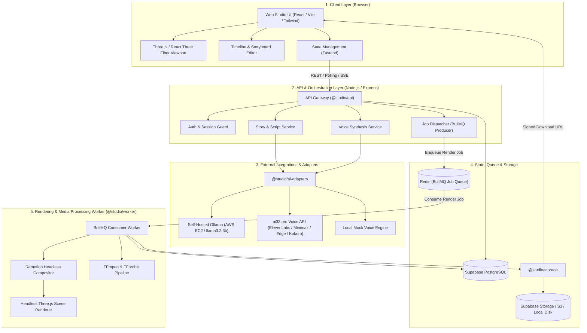
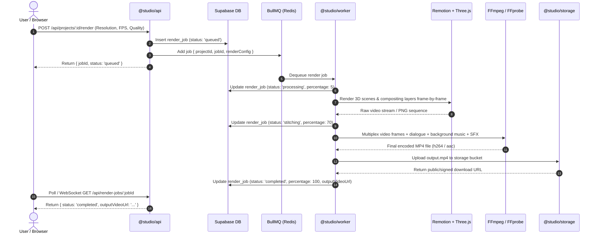

# 3D Animated Shorts Studio — System Architecture

## 1. Executive Summary

**3D Animated Shorts Studio** is a full-stack, modular, AI-assisted 3D animated video production platform. It enables creators to transform raw story concepts into fully realized, 9:16 vertical cartoon animated shorts and YouTube Shorts with genuine 3D environments, animated stylized characters, multi-track audio, and exported high-definition MP4 videos.

The system is designed with strict enterprise-grade boundaries:
- **No Client-Side Video Rendering:** All intensive frame composition, 3D rasterization, and FFmpeg encoding happen in dedicated background worker processes.
- **Genuine 3D Animation:** Scenes use actual Three.js meshes, bones, rigs, blend shapes, and keyframed camera paths, avoiding static 2D slideshows or image cross-fading.
- **Zero Fabricated Functionality:** Every progress bar, state change, and status report reflects real backend and worker events.
- **AI & Voice Architecture:** AI reasoning uses a dedicated self-hosted Ollama adapter (`llama3.2:3b` on AWS EC2); voice synthesis uses pluggable adapters (ai33.pro Unified v3 or local mock voice adapter).
- **Strict Secrets Isolation:** Private provider keys and database service roles are confined to the backend and worker processes; the client bundle receives zero secrets.

---

## 2. High-Level Architecture Diagram

---

## 3. Dedicated Core Component Architectures

The system is decomposed into nine specialized domains:

### 3.1. Frontend Studio (`apps/web`)
- **Technology:** React 18, Vite 5, Tailwind CSS, shadcn/ui primitives, Lucide icons, Zustand state stores.
- **Responsibilities:**
  - Hosts the interactive 3D WebGL viewport powered by React Three Fiber and Drei.
  - Interactive multi-track timeline sequencer (scrubbing, keyframing, scene cuts).
  - Story prompt composer and interactive scene script editor.
  - Character customizer (palette picker, proportion sliders, emotion previews).
  - Guided export modal displaying authentic real-time rendering progress received from the API.
- **Isolation:** Receives zero private API keys or database service tokens. Communicates with `apps/api` via REST and SSE/WebSockets.

### 3.2. API Gateway & Orchestration (`apps/api`)
- **Technology:** Node.js 20, Express, Zod validation, BullMQ Producer, ioredis.
- **Responsibilities:**
  - Validates all incoming client payloads against strict `@studio/types` Zod schemas.
  - Coordinates story generation by querying `@studio/ai-adapters`.
  - Coordinates voice synthesis and speech asset management.
  - Manages project persistence in Supabase (`projects`, `stories`, `scenes`, `characters`).
  - Dispatches render jobs to Redis BullMQ queue with unique tracking IDs.
  - Exposes health checks and job progress polling endpoints.

### 3.3. Background Rendering Worker (`apps/worker`)
- **Technology:** Node.js 20, BullMQ Consumer, Headless Chromium, Remotion Renderer, FFmpeg/FFprobe.
- **Responsibilities:**
  - Dequeues `render-short` jobs from Redis.
  - Renders 3D scenes frame-by-frame offscreen at 1080x1920 (9:16 vertical video) at 30 FPS.
  - Packages visual frames and audio stems into Remotion compositions.
  - Invokes FFmpeg to multiplex video frames, dialogue audio, background music, and sound effects into H.264/AAC MP4 containers.
  - Streams frame progress (0–100%) back to Redis and Supabase.
  - Uploads completed MP4 files to object storage and marks jobs completed.

### 3.4. Relational Database & Persistence (`packages/database` & Supabase)
- **Technology:** Supabase Managed PostgreSQL, Row-Level Security (RLS), Supabase JS Client.
- **Data Entities:**
  - `projects`: Metadata, aspect ratio (9:16), FPS, target duration, project status.
  - `stories`: Concept prompt, logline, structured narrative arc, scene script JSON.
  - `characters`: Rig definitions, stylized proportions, color palettes, voice ID.
  - `scenes`: Scene number, environment presets, camera track, 3D object list, animation tracks.
  - `audio_tracks`: Type (voiceover, music, SFX), asset URL, start time, volume, duration.
  - `render_jobs`: Job status, frame percentage, output video URL, error traces.

### 3.5. AI Reasoning & Story Engine (`packages/ai-adapters`)
- **Technology:** Self-hosted Ollama LLM adapter running on AWS EC2 with Zod schema extraction.
- **Provider Architecture:**
  - **Self-Hosted Ollama Adapter (Exclusive LLM):** Connects to the local/private Ollama daemon on AWS EC2 at `http://127.0.0.1:11434` running `llama3.2:3b`. All generation requests route server-side through the backend Express API. Direct browser connections to Ollama are strictly prohibited.
- **Reliability:** Automated markdown fence stripping, JSON schema repair, and explicit error reporting if AWS EC2 Ollama is unreachable.

### 3.6. 3D Engine & Character Rigging (`packages/3d-engine`)
- **Technology:** Three.js 0.169.
- **Capabilities:**
  - **Procedural Character Rig:** Stylized humanoid and creature skeletons with bone hierarchies (head, neck, spine, limbs).
  - **Facial Blend Shapes:** Dynamic morph targets for emotions (happy, sad, excited, angry, surprised, confused).
  - **Lighting & Environment Presets:** Stylized procedural skies, directional sunlight, ambient fill, and fog presets (Daylight, Golden Hour, Cyberpunk, Noir).
  - **Keyframe Interpolator:** Cubic Bezier and ease-in-out transformations for bones, objects, and camera coordinates.

### 3.7. Video Compositor (`packages/video-compositor`)
- **Technology:** Remotion 4.0.
- **Responsibilities:**
  - Defines the parameterized root video composition schema (`ShortCompositionProps`).
  - Orchestrates sequential scene cut points and cross-fades.
  - Renders kinetic cartoon typography, subtitles, and lower-third captions synced to speech cues.
  - Maps 3D rendered frames to Remotion `<Sequence>` layers.

### 3.8. Audio Processing & Speech Synthesis (`packages/ai-adapters` + FFmpeg)
- **Technology:** `ai33.pro` Unified v3 API client (supporting ElevenLabs, Minimax, Clone, Edge, Kokoro, Vbee, and FishAudio voice models), Web Audio API (client preview), FFmpeg `amix` / `volume` audio filter graphs.
- **Capabilities:**
  - **TTS & Multi-Speaker Dialogue Synthesis:** High-quality character dialogue audio generation supporting single TTS (`POST /v3/text-to-speech`) and multi-speaker dialogue sequencing (`POST /v3/text-to-speech/dialogue`) with customizable speaker delays.
  - **Voice Library & Cloning:** Normalized voice catalogue across multiple engines, plus custom voice cloning (`POST /v3/text-to-speech/voice-clone`).
  - **Pronunciation Dictionaries:** Custom word-replacement rules (`/v3/dictionaries`) to maintain correct character names and cartoon terminology in synthesized speech.
  - **Dialogue Timing Alignment:** Audio track duration dynamically determines scene frame length.
  - **Speech Lip-Sync Approximation:** Character jaw and mouth blend shapes articulate synchronously to speech audio volume envelopes.
  - **Multi-Track Mixing:** FFmpeg mixes dialogue, auto-ducked background music, and sound effects with volume envelopes and fade-in/fade-out transitions.

### 3.9. Unified Storage Adapter (`packages/storage`)
- **Technology:** Pluggable `IStorageAdapter` interface.
- **Supported Backends:**
  - **Local Filesystem Adapter:** Writes assets and renders to local disk (`./storage_data`), ideal for offline development and testing.
  - **Supabase Storage Adapter:** Direct S3-compatible cloud bucket storage for assets and renders.
  - **AWS S3 / Cloudflare R2 Adapter:** Standard enterprise object storage.
- **Safety:** Generates time-limited signed URLs for user download without exposing bucket permissions.

---

## 4. Inter-Process Communication & Data Flow

### 4.1. Story & Script Generation Flow
1. **User Request:** The creator enters a concept prompt in `apps/web` (e.g. *"A clumsy robot trying to bake a cake"*).
2. **API Dispatch:** `apps/web` sends a `POST /api/stories/generate` request to `apps/api`.
3. **AI Adapter Orchestration:** `apps/api` selects the configured AI adapter (`@studio/ai-adapters`). It submits a structured prompt requiring strict JSON adherence to `@studio/types:StoryDocument`.
4. **Validation:** The AI response is parsed and validated using Zod against `StoryDocumentSchema`. If invalid, retry or fallback models are triggered.
5. **Persistence:** The generated story, scene breakdowns, character prompts, and estimated timings are saved to Supabase.
6. **Delivery:** The structured story is returned to `apps/web`, where the creator can review, edit, or approve each scene before proceeding.

### 4.2. 3D Scene Setup & Real-time Viewport
1. **Interactive Client Scene:** In `apps/web`, the React Three Fiber viewport instantiates real Three.js objects based on the approved scene script.
2. **Character Rigging:** The character's procedural mesh is generated using `@studio/3d-engine`, attaching bone structures for head, eyes, mouth, torso, and limbs.
3. **Keyframe Animation:** Character poses (happy, surprised, confused) and camera vectors (close-up, pan, Dutch angle) are calculated and previewed at 60 FPS in the browser canvas.

### 4.3. Voiceover & Audio Synthesis Flow
1. **Dialogue Extraction:** `apps/api` receives dialogue lines associated with each character.
2. **TTS / Multi-Speaker Synthesis:** The voice adapter invokes `ai33.pro` Unified v3 API (or the deterministic voice mock) to generate an audio buffer (`.mp3`/`.wav`) and transcripts.
3. **Audio Upload:** The generated audio file is stored via `@studio/storage` in the project assets bucket.
4. **Sync Metadata:** Audio URLs, durations, and character mouth-movement cues are saved to Supabase and synced to the client timeline.

### 4.4. Video Rendering & Export Pipeline
Heavy video rendering is **never executed in the client browser**. The export lifecycle proceeds as follows:

---

## 5. Security Architecture & Secrets Isolation

1. **Client Isolation:** `apps/web` is compiled with Vite. Only environment variables prefixed with `VITE_` are bundled into client code.
2. **Secret Containment:** Provider API keys (`OLLAMA_API_KEY`, `AI33_API_KEY`, `SUPABASE_SERVICE_ROLE_KEY`) are exclusively accessible to `apps/api` and `apps/worker` via runtime environment variables.
3. **Database Row Level Security (RLS):** Supabase database tables enforce RLS policies tied to the authenticated user ID. The backend API uses the `service_role` key strictly when executing authorized system operations.
4. **CORS & Rate Limiting:** The backend API restricts origins to authorized client domains and implements strict rate limits on AI generation and render triggers.

---

## 6. Fault Tolerance & Recovery Strategies

- **BullMQ Auto-Retry:** Network blips during third-party AI or voice generation trigger exponential backoff retries (up to 3 attempts).
- **Graceful Worker Shutdown:** Workers handle `SIGTERM` and `SIGINT` signals by finishing current frame renders or marking the job as failed with an explanatory error trace rather than leaving zombie jobs.
- **Render Crash Isolation:** If a headless Chrome instance or FFmpeg process crashes, the worker catches the exit code, cleans up temporary frame directories (`renders/temp`), and updates the database record with a recoverable error status.
- **Mock Voice Fallback:** Setting `MOCK_VOICE=true` allows full voice testing and local development without calling external voice APIs.
