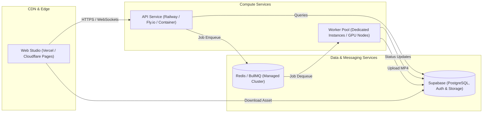

# 3D Animated Shorts Studio — Deployment & Infrastructure Specification

## 1. Production Topology & Architecture

The production environment consists of decoupled services, allowing each component to scale independently based on load:



---

## 2. Infrastructure Components

### 2.1. Web Frontend (`apps/web`)
- **Hosting Target:** Vercel, Netlify, or Cloudflare Pages.
- **Build Command:** `pnpm --filter @studio/web build`
- **Output Directory:** `apps/web/dist`
- **Configuration:** Static SPA with client-side routing fallback (`/* -> /index.html`).

### 2.2. Backend API (`apps/api`)
- **Hosting Target:** Container runtime (Railway, Fly.io, AWS ECS, or Render).
- **Runtime:** Node.js 20+ LTS (Alpine or Debian-slim).
- **Resource Sizing:** 1 vCPU, 1 GB RAM (scales horizontally with HTTP traffic).
- **Port:** 4000 (configurable via `API_PORT`).

### 2.3. Background Rendering Worker (`apps/worker`)
- **Hosting Target:** Dedicated compute instances with hardware acceleration or high CPU core counts (AWS EC2 c6i / g4dn, Hetzner, or Fly.io compute).
- **Runtime Requirements:**
  - Node.js 20+ LTS.
  - FFmpeg 6.0+ and FFprobe.
  - Headless Chromium / Puppeteer dependencies (e.g. `libnss3`, `libatk1.0-0`, `libgbm1`).
  - WebGL software rasterizer fallback (`swiftshader` / `mesa`) or GPU passthrough (`/dev/dri`).
- **Resource Sizing:**
  - Minimum: 2 vCPU, 4 GB RAM (can process 1 short at 30 FPS).
  - Recommended: 4-8 vCPU, 8-16 GB RAM with GPU passthrough for fast concurrent renders.
- **Worker Auto-Scaling:** Auto-scale worker pool based on BullMQ `waiting` queue depth.

### 2.4. Managed Database & Storage (Supabase)
- **Database:** Supabase Managed PostgreSQL with Row-Level Security (RLS) enabled.
- **Storage Buckets:**
  - `studio-assets`: Character models, textures, generated speech clips, audio files.
  - `studio-renders`: Completed `.mp4` video exports and thumbnail previews.

### 2.5. Job Queue (Redis)
- **Engine:** Redis 7.0+ (Upstash, AWS ElastiCache, or Redis Cloud).
- **Eviction Policy:** `noeviction` (critical for BullMQ message durability).

---

## 3. Containerization Blueprints

### 3.1. API Container (`apps/api/Dockerfile`)
```dockerfile
FROM node:20-alpine AS base
RUN corepack enable && corepack prepare pnpm@9.12.3 --activate
WORKDIR /app

FROM base AS builder
COPY . .
RUN pnpm install --frozen-lockfile
RUN pnpm --filter @studio/api build

FROM base AS runner
ENV NODE_ENV=production
COPY --from=builder /app /app
WORKDIR /app/apps/api
EXPOSE 4000
CMD ["node", "dist/index.js"]
```

### 3.2. Rendering Worker Container (`apps/worker/Dockerfile`)
```dockerfile
FROM node:20-bookworm-slim AS worker-base
# Install FFmpeg, Chromium, and graphical rendering libraries
RUN apt-get update && apt-get install -y --no-install-recommends \
    ffmpeg \
    chromium \
    fonts-freefont-ttf \
    libnss3 \
    libatk1.0-0 \
    libgbm1 \
    libasound2 \
    && rm -rf /var/lib/apt/lists/*

ENV PUPPETEER_EXECUTABLE_PATH=/usr/bin/chromium
ENV PUPPETEER_SKIP_CHROMIUM_DOWNLOAD=true
ENV FFMPEG_PATH=/usr/bin/ffmpeg
ENV FFPROBE_PATH=/usr/bin/ffprobe

RUN corepack enable && corepack prepare pnpm@9.12.3 --activate
WORKDIR /app

COPY . .
RUN pnpm install --frozen-lockfile
RUN pnpm --filter @studio/worker build

WORKDIR /app/apps/worker
ENV NODE_ENV=production
CMD ["node", "dist/index.js"]
```

---

## 4. Environment Variables Checklist for Production

| Variable | Required In | Description |
| :--- | :--- | :--- |
| `NODE_ENV` | API, Worker | Must be `production` |
| `SUPABASE_URL` | API, Worker, Web | Supabase project URL |
| `SUPABASE_ANON_KEY` | Web | Client anon key |
| `SUPABASE_SERVICE_ROLE_KEY` | API, Worker | Service role key for administrative operations |
| `REDIS_HOST`, `REDIS_PORT`, `REDIS_PASSWORD` | API, Worker | BullMQ connection credentials |
| `OLLAMA_BASE_URL` | API | Local Ollama endpoint on EC2 (`http://127.0.0.1:11434`) |
| `OLLAMA_MODEL` | API | Ollama model name (`llama3.2:3b`) |
| `OLLAMA_API_KEY` | API | Optional bearer key if Ollama reverse proxy requires auth |
| `AI33_API_KEY` | API | `ai33.pro` speech synthesis & dialogue key |
| `STORAGE_PROVIDER` | API, Worker | `supabase` or `s3` in production |
| `WORKER_CONCURRENCY` | Worker | Number of simultaneous render jobs (default: 2) |
| `PUPPETEER_EXECUTABLE_PATH` | Worker | Path to headless browser executable |
| `FFMPEG_PATH` | Worker | Path to system FFmpeg executable |

---

## 5. Health Checks & Observability

- **API Health Endpoint:** `GET /health` returns `{ status: "ok", timestamp: "..." }`.
- **Worker Heartbeat:** Workers maintain a Redis lock and update their status in `render_jobs` every 5 seconds during active rendering.
- **Monitoring:** Sentry or Datadog for error tracking; Prometheus metrics for BullMQ queue lag and render durations.

