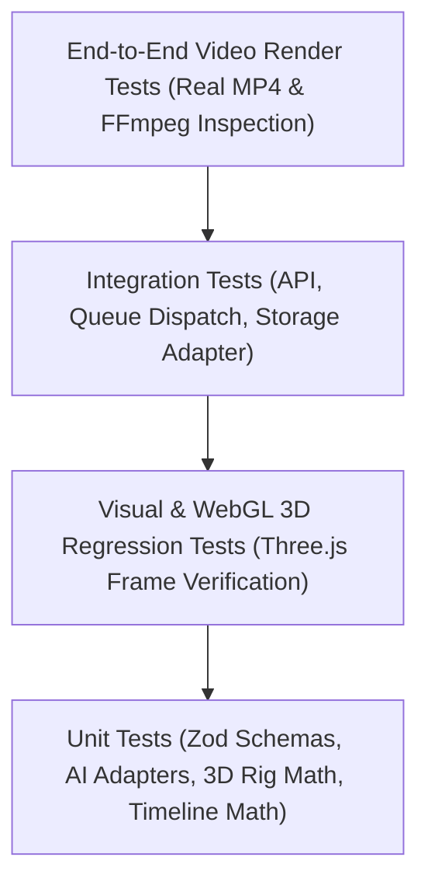

# 3D Animated Shorts Studio — Testing & Verification Strategy

## 1. Testing Philosophy & Standards

To ensure production-grade reliability across complex real-time 3D, AI orchestration, audio synthesis, and headless video rendering, **3D Animated Shorts Studio** enforces a multi-tiered testing strategy:
1. **Zero Mocked Deliverables:** While external speech APIs support mock adapters for offline audio testing, the actual 3D rendering, canvas composition, and video multiplexing pipelines must execute real computations and produce real output files.
2. **Type Safety as First-Line Verification:** Every package must pass strict TypeScript type checking (`tsc --noEmit`) with zero implicit anys and no unchecked indexed accesses.
3. **Deterministic CI/CD Execution:** Tests must run without network access or external credentials by leveraging test harness mocks (`MOCK_VOICE=true`, `STORAGE_PROVIDER=local`).

---

## 2. Test Pyramid & Scope



---

## 3. Test Layers Detailed

### 3.1. Unit Testing
- **Locations:** `packages/types`, `packages/ai-adapters`, `packages/3d-engine`, `packages/video-compositor`.
- **Framework:** Vitest.
- **Coverage Targets:**
  - **Schema Validation:** Ensure `StoryDocumentSchema`, `CharacterDefinitionSchema`, and `RenderJobSchema` accept valid JSON and cleanly reject incomplete or malformed structures.
  - **AI Prompt & Output Parsers:** Verify that raw LLM text responses (including markdown-fenced JSON blocks) are properly extracted, validated, and normalized.
  - **3D Bone & Transform Math:** Test Euler angle conversions, bone hierarchy attachment, and cubic Bezier curve interpolation.
  - **Timeline Time-to-Frame Math:** Validate frame calculation formulas for 30 FPS across scene transitions.

### 3.2. Integration Testing
- **Locations:** `apps/api`, `apps/worker`, `packages/storage`, `packages/database`.
- **Framework:** Vitest + Supertest.
- **Key Scenarios:**
  - **API Project Endpoints:** Create, read, update, and delete operations on projects, stories, and scenes.
  - **Story Generation Route:** Submitting a concept prompt yields a 200 response with structured scenes conforming strictly to schema.
  - **Storage Adapter:** Verify local disk upload, read, and delete operations; verify signed URL generation.
  - **Queue Enqueue & Dequeue:** Test that `apps/api` successfully adds a job to BullMQ and `apps/worker` receives the job payload.

### 3.3. 3D Engine & Visual Verification Testing
- **Locations:** `packages/3d-engine`, `apps/web`.
- **Framework:** Playwright + Headless Chromium with WebGL enabled (`--use-gl=angle` or `--use-gl=swiftshader`).
- **Key Scenarios:**
  - **Canvas Initialization:** Verify React Three Fiber canvas mounts, loads shader programs, and produces a valid WebGL context.
  - **Procedural Rigging:** Inspect that character bone count matches expected hierarchy.
  - **Frame Capture Verification:** Render a single 3D scene frame to a canvas and verify that the canvas buffer contains non-zero pixel data (confirming actual 3D geometry rendered, not an empty or black frame).

### 3.4. Video & Audio Composition Verification
- **Locations:** `apps/worker`, `packages/video-compositor`.
- **Verification Tools:** Remotion CLI (`remotion render`) + FFprobe.
- **Key Scenarios:**
  - **Remotion Composition Render:** Render a 5-second test composition to `/renders/temp/test_output.mp4`.
  - **FFprobe Codec Inspection:**
    - Format: `mp4`
    - Video Codec: `h264`
    - Dimensions: `1080x1920`
    - Frame Rate: `30 fps`
    - Audio Codec: `aac`
    - Audio Channels: 2 (Stereo)
  - **File Size & Playback Check:** Verify the file is greater than 0 bytes and has a valid MOOV atom header.

---

## 4. Test Execution Commands

```bash
# Run all workspace unit and integration tests
pnpm test

# Run strict type checking across all apps and packages
pnpm typecheck

# Run linter across all projects
pnpm lint

# Run specific package tests
pnpm --filter @studio/types test
pnpm --filter @studio/ai-adapters test
pnpm --filter @studio/3d-engine test
pnpm --filter @studio/api test
pnpm --filter @studio/worker test

# Run E2E test suite (Headless browser + Worker test)
pnpm test:e2e
```

---

## 5. Phase-by-Phase Verification Gate

Before any phase is marked as completed in `docs/PROGRESS.md`, the following verification checklist must be executed and documented:

1. **Clean Typecheck:** `pnpm typecheck` must exit with code 0.
2. **Clean Test Suite:** `pnpm test` must pass all test suites.
3. **Reproducible Local State:** The application must start cleanly in development mode (`pnpm dev`) without runtime exceptions.
4. **Demonstrable Feature:** The phase's core capability must be demonstrable in browser or terminal (e.g., actual AI story generated, actual 3D character displayed, or actual MP4 produced).
5. **Architect Review:** Documentation updated, zero unhandled errors, user sign-off requested.

